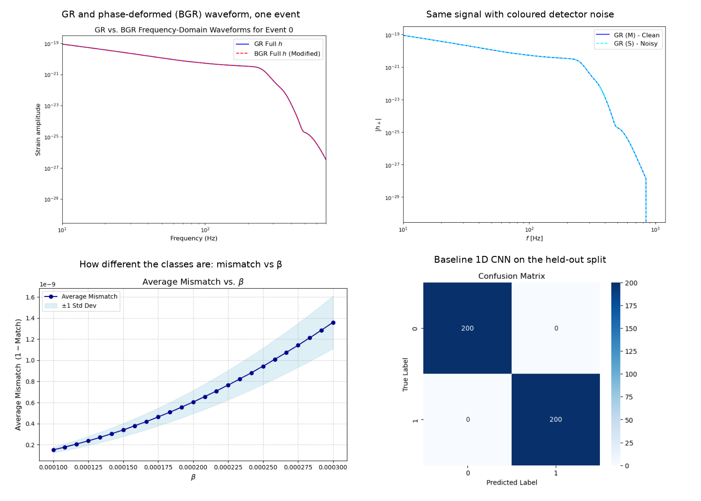
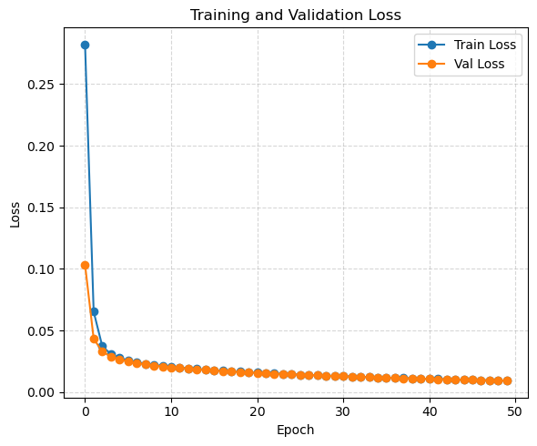
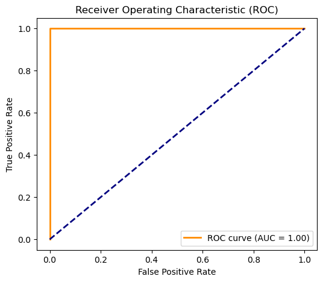

# GR vs beyond-GR classification of gravitational-wave signals with a 1D CNN

Can a small convolutional network tell a general-relativity (GR) binary black hole signal from one whose phase carries a tiny beyond-GR (BGR) correction, once both are buried in detector noise? This notebook builds the whole pipeline needed to ask that question: real catalogue parameters, physically generated waveforms, a controlled phase deformation, coloured detector noise, and a baseline classifier with an honest evaluation section.



## Pipeline

1. **Catalogue parameters.** 121 binary black hole events (source-frame masses, effective spin, redshift) from the GWTC catalogues as distributed by GWOSC: [`data/bbh_events.csv`](data/bbh_events.csv).
2. **Augmentation.** Every event is perturbed ten times (masses and effective spin jittered by 3 to 5 percent, ordering and physical bounds enforced), giving 1,331 parameter sets that stay inside the observed population.
3. **Waveforms.** Frequency-domain IMRPhenomXHM waveforms generated with PyCBC, including the (2,2) and (2,1) modes, against the detector power spectral density.
4. **Beyond-GR deformation.** A Gaussian phase shift of amplitude β is applied to each GR waveform. For β up to 3 × 10⁻⁴ the match between the GR and BGR versions stays above 0.999999, so the two classes are almost identical by construction.
5. **Noise.** Coloured Gaussian noise drawn from the detector PSD is added to both versions of every event.
6. **Features.** The real part of the response function, interpolated onto a common 1,000-point grid between 10 and 400 Hz.
7. **Classifier.** A three-block 1D CNN (16, 32 and 64 filters, kernel 3, max pooling, L2 regularisation, 128-unit dense head, logit output) trained with binary cross-entropy for 50 epochs on a 70/15/15 train, validation and test split (1,863 / 399 / 400 samples).

## Result

<p align="center">
  
  
</p>

At β = 3 × 10⁻⁴ the network separates the two classes completely on the held-out split: 400 test samples, accuracy, precision, recall and F1 all 1.00, AUC 1.00. Training and validation loss fall together over the 50 epochs.

## Read the result with care

- **The split is not grouped by source event.** Augmented copies of the same catalogue event can land on both sides of the train/test split, so the test set is not independent of training. The numbers above are an upper bound, not a detection claim. The first item in the next-steps list fixes this.
- **One β, one noise model.** The deformation strength is fixed and the noise is stationary Gaussian noise from a single PSD. Real detector data has glitches and non-stationarity.
- **Small population.** Everything descends from 121 real events, so the diversity of the training set is limited by design.

## Next steps

1. Split by source event (`GroupShuffleSplit`), repeat over seeds, and report the metrics with confidence intervals.
2. Sweep β downward to find the smallest deformation the classifier still detects, and compare it with the match-based threshold.
3. Calibrate the output probabilities and summarise the evidence per event.

## Where this went

This notebook is an early baseline from my PhD work at Universität Heidelberg. The full studies are:

- L. Heisenberg, S. Hemmatyar, H. Villarrubia-Rojo. *Testing General Relativity Through Gravitational Wave Classification: A Convolutional Neural Network Framework.* [arXiv:2605.02453](https://arxiv.org/abs/2605.02453) (2026).
- L. Heisenberg, S. Hemmatyar. *Identifiability Limits of Gravitational Wave Phase Deviations: Multiclass Classification with a Multihead Neural Network.* [arXiv:2609.31993](https://arxiv.org/abs/2609.31993) (2026).
- PhD thesis: [*Theoretical and Machine Learning Approaches to Beyond General Relativity*](https://doi.org/10.11588/heidok.00036791), Universität Heidelberg, 2025.

## Run it

```bash
conda env create -f environment.yml
conda activate gw-ml
jupyter lab notebooks/gr_bgr_cnn_binary.ipynb
```

Generating waveforms for 1,331 events takes a while on a laptop. The notebook keeps all its outputs, so the results can be read on GitHub without running anything.

## Layout

| Path | Contents |
|---|---|
| `notebooks/gr_bgr_cnn_binary.ipynb` | The whole pipeline, outputs included |
| `data/bbh_events.csv` | The 121 catalogue events used as seeds |
| `figures/` | Figures exported from the notebook |
| `environment.yml` | Conda environment: PyCBC, LALSuite, TensorFlow, scikit-learn |

## Data

Source-frame masses, effective spin and redshift of 121 binary black hole events, as published by the LIGO, Virgo and KAGRA collaborations in the GWTC catalogues and distributed through the Gravitational Wave Open Science Center (GWOSC).

## License

MIT. See [LICENSE](LICENSE).
